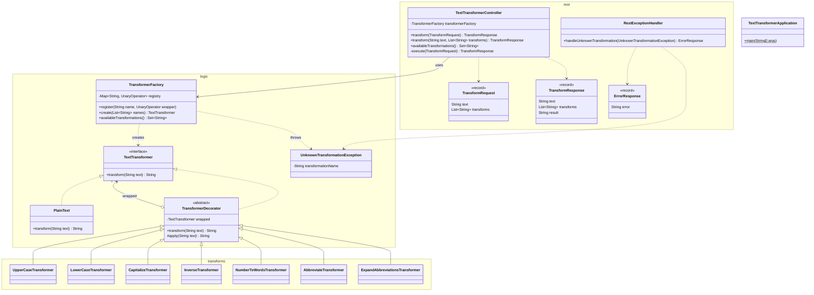

# Diagram klas

Wzorzec **Dekorator**. Klasy w `transforms` to transformacje na Sprint 1 – trzymamy się tych nazw.

Żądanie `["inverse", "upper"]` daje `UpperCaseTransformer(InverseTransformer(PlainText))`.
Każdy dekorator najpierw puszcza tekst przez owinięty obiekt, potem robi swoje `apply`,
więc kolejność jest taka jak w żądaniu.
